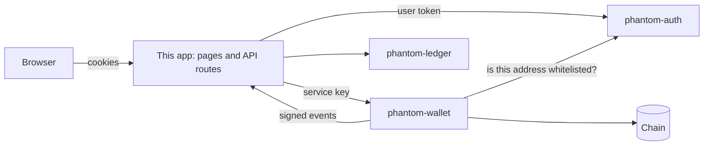

# phantom-exchange-app

The account area of a crypto exchange, and the piece that joins the backend services together. People sign in, turn on two-factor, keep a list of withdrawal addresses, deposit, withdraw, and see their balances. Behind the screens, this app talks to the auth, ledger, and wallet services and keeps them in step.

> Test network only. Demo and portfolio project, not audited.

## Screens

| Screen | What it does |
|---|---|
| Sign in, Register | Password sign-in, then an authenticator code or backup code when two-factor is on. |
| Overview | Available and held balances, recent deposits and withdrawals, and a prompt to turn on two-factor. |
| Deposit | The user's own address with a QR code and a copy button, and deposit history with progress. |
| Withdraw | Choose an asset, a saved address, and an amount. Shows history with live progress. |
| Security | Set up two-factor with a QR code and one-time backup codes. Add, confirm, and remove withdrawal addresses. Sign out everywhere. Read the account's activity log. |

On phones the sidebar becomes a bottom bar (Overview, Deposit, Withdraw, Security).

## How the pieces fit



The browser never sees an API key and never talks to the ledger or wallet. Its session lives in two `httpOnly` cookies. The app's API routes check the session with the auth service on every request, refresh it when it expires, and then call the other services on the user's behalf, always with the user id taken from the session.

### A deposit

1. The wallet sees a transfer to the user's address and waits for confirmations.
2. It sends a signed `deposit.confirmed` event to `/api/webhooks/wallet`.
3. The app checks the signature and credits the ledger, using the event id as the idempotency key, so a repeated event credits once.

### A withdrawal

1. The user picks one of their own active addresses. The app looks the address up on the server, so the browser never supplies one.
2. The ledger locks the funds. Its withdrawal id becomes the wallet's idempotency key.
3. The wallet checks the whitelist with the auth service, applies its limits, and queues the payout.
4. **If the wallet clearly refuses**, the app tells the ledger to release the held funds.
5. **If the answer is unclear** (timeout, crash), the funds stay held. Releasing them could allow a double spend if the wallet did accept the request.
6. When the transaction is confirmed or fails, the wallet's event settles the ledger withdrawal to match.

Repeating a request with the same id is safe at every step.

## Run the whole stack

Start PostgreSQL and Redis, a local chain (`npx hardhat node` in phantom-wallet), then each service. The settings that connect them:

| Service | Settings |
|---|---|
| phantom-auth | `SERVICE_API_KEY` (shared with the wallet), `TRUST_PROXY=true` only when it is reachable from this app alone |
| phantom-wallet | `API_KEY` (this app's `WALLET_API_KEY`), `WHITELIST_URL` and `WHITELIST_SERVICE_KEY` (the auth service and its `SERVICE_API_KEY`), `WEBHOOK_URL=<this app>/api/webhooks/wallet`, `WEBHOOK_SECRET` (this app's `WALLET_WEBHOOK_SECRET`) |
| phantom-ledger | nothing, but keep it off the public network |
| this app | `AUTH_URL`, `WALLET_URL`, `LEDGER_URL`, `WALLET_API_KEY`, `WALLET_WEBHOOK_SECRET`, `COOKIE_SECURE=false` only for plain http on localhost |

```bash
npm install
cp .env.example .env.local     # fill in the values
npm run dev                    # http://localhost:3100
npm test                       # unit tests, no services needed
npm run e2e                    # full user journey against the live services
```

`npm run e2e` needs `WALLET_API_KEY`, `WALLET_WEBHOOK_SECRET`, `AUTH_LOG` (the auth service's console output, where the development mailer prints the address confirmation code), and `RPC_URL`. For a quick run, give the auth service `WHITELIST_DELAY_HOURS=0.0006` so a new address is ready in a couple of seconds.

## What is checked

- **Unit tests (35):** amount parsing without float error, the withdrawal flow with fakes for every failure, event handling and signature checks, and the shared token refresh.
- **End-to-end journey (58 checks, run against the real services and a local chain):** sign-up, sign-in, two-factor with a wrong code, a right code, and backup codes; adding, confirming, and removing an address; a deposit that is credited exactly once; a withdrawal that reaches the recipient for exactly the amount, with the hold released after confirmation; repeating the same request; amounts that are too large or malformed; a wallet refusal that returns the held funds; forged and unsigned events; the ledger's books balancing at the end; and sign-out-everywhere ending the old session at once.

To confirm those checks can fail, two safeguards were removed on purpose (the refund after a wallet refusal, and the webhook signature check). The journey caught both.

## Threat model

| Threat | What this app does |
|---|---|
| A page on another site makes the browser send a request | Cookies are `SameSite=Lax`, and every POST must carry an `Origin` that matches this site. |
| Stolen API key | The wallet key lives only on the server. Browsers never receive it. |
| Withdrawal to an address the user did not choose | The destination is looked up server-side from the user's own whitelist, and the wallet checks it again with the auth service. |
| Double withdrawal from a double click or retry | Each attempt carries a request id. The ledger and the wallet both treat a repeat as the same withdrawal. |
| Forged deposit or withdrawal event | Events are signed with HMAC-SHA256 and compared in constant time. Unsigned or wrongly signed events get 401. |
| Lost or repeated events | Events are delivered at least once and every handler is safe to repeat. A ledger outage returns an error, so the wallet sends the event again. |
| Many tabs refreshing the session at once | Refresh tokens work once. Simultaneous requests share one refresh instead of each trying their own and ending the session. |
| All users sharing one rate limit | The user's IP and browser are forwarded to the auth service, so limits and the audit log are per person. |
| Browser-side tampering with amounts | The server parses amounts as exact base units and rejects anything that is not a plain positive decimal. |

## Known limits

- **The screens are not browser-tested.** They are built, type-checked, and every flow behind them is covered by the journey above. They have not had a visual pass, a screen reader pass, or a cross-browser pass.
- **The ledger has no login of its own.** Only this app should be able to reach it. Put it on a private network.
- **An unclear wallet answer leaves funds held.** That is the safe choice, but nothing yet re-checks those withdrawals later. A reconciliation job is the next piece.
- **Refresh sharing covers one server process.** With several, send each user's requests to the same one.
- **Email is a placeholder.** In development the confirmation code is printed in the auth service's console.
- **No email verification or password reset yet.**
- **The asset list is duplicated.** `lib/assets.ts` must match the wallet's `ASSETS_JSON`.
- **Withdrawals are not asked for a second code.** Two-factor protects sign-in and adding addresses. A per-withdrawal prompt would need a verify endpoint in the auth service.

## Structure

```
app/(auth)/      sign in, register
app/(app)/       overview, deposit, withdraw, security
app/api/         routes the browser calls, plus the wallet webhook
lib/             session, withdrawal flow, event handling, amounts, service clients
components/      shell, form controls, status badges
scripts/e2e.mjs the end-to-end journey
design-system/   the design decisions in one page
```
